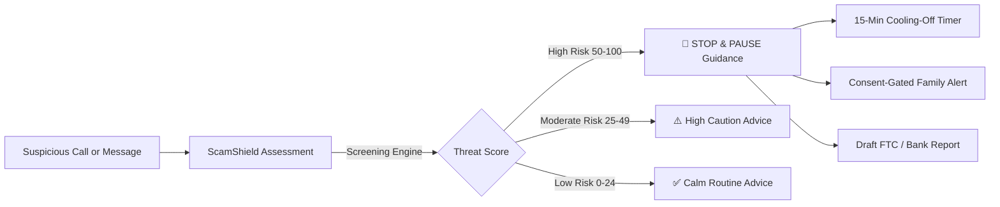

# ScamShield AI 🛡️

> **An Accessible Scam-Intervention Assistant for Older Adults & Caregivers**  
> *Prepared for Open-Source Publication and the Amazon Developer Hackathon*

[](https://fastapi.tiangolo.com)
[](https://react.dev)
[](https://aws.amazon.com/bedrock/)
[](https://www.w3.org/WAI/standards-guidelines/wcag/)
[](LICENSE)
[-brightgreen.svg)]()

---

## 📌 Problem Statement & Intended Users

Older adults lose more than **$3.4 billion annually** to financial fraud, imposter phone calls, fake bank security alerts, and grandchild emergency schemes. Scammers deliberately manufacture **panic, artificial urgency, and forced secrecy** to force victims into transferring money before their cognitive defenses or loved ones can intervene.

Existing security tools are built for enterprise IT, filled with dense technical jargon, tiny fonts, and complex authentication flows. 

**ScamShield AI** is designed specifically for **older adults and their family caregivers**. It provides an empathetic, highly accessible, real-time decision-support interface that helps vulnerable users pause the rush, evaluate suspicious interactions, and take protective action safely.

---

## ⚠️ Important Prototype Disclosures & Safety Boundaries

1. **Dual Evaluation Architecture (Local Heuristics Default + AWS Bedrock Ready):**
   - **Default Mode (`mock_synthetic`):** Runs an offline, transparent, rule-based synthetic heuristics engine (`SyntheticMockProvider`). **No AWS credentials or cloud connections are required to run the app or execute tests.**
   - **AWS Bedrock Provider (`aws_bedrock`):** An enterprise-ready provider using the official AWS SDK for Python (`boto3`) to evaluate complex interactions using foundation models (e.g., Anthropic Claude 3 Haiku or Claude 3.5 Sonnet).
   - **Safe Automatic Fallback:** If Bedrock is enabled but AWS credentials expire, are missing, or encounter network errors, the system safely falls back to local synthetic heuristics without crashing or leaking secrets.
2. **Voluntary Decision-Support Only:**
   - ScamShield AI **DOES NOT** perform automatic bank transfers, automated payment blocking, real-time telephone call interception, or unauthorized audio recording.
3. **Multimodal Alexa+ Experience is a UI Simulation:**
   - The Echo Show 10 / "Alexa+" interface is a **browser-based multimodal simulation** demonstrating how an ambient smart display assistant assists seniors. It utilizes browser Web Speech APIs (`webkitSpeechRecognition` and `window.speechSynthesis`) and local/Bedrock backend routes, rather than an official Alexa Skills Kit (ASK) or Alexa Voice Service (AVS) cloud deployment.
4. **Zero Sensitive PII Retention:**
   - In accordance with elder privacy safeguards, no Social Security numbers, banking credentials, or private contact identifiers are stored.
5. **Trusted-Contact Alerts Require Explicit Affirmative Consent:**
   - Simulating alerts to family members requires interactive, explicit confirmation (`explicit_consent: true`). In this prototype, notifications are **simulated safely** with real-time message previews and zero external SMS or email transmission.
6. **Untrusted Input Protection & Anti-Jailbreak Guardrails:**
   - All user-submitted text is wrapped in `<untrusted_suspicious_message>` tags. System prompts strictly forbid models from following instructions contained inside suspicious messages or executing financial transactions.

---

## 🌟 Core Features & User Workflow



### 1. Elder-Accessible Interface
- **3-Tier Typography Switcher:** Instantly switch between Standard (`A`), Large (`A+`), and Extra-Large (`A++`) text.
- **High-Contrast Design Tokens:** WCAG AAA/AA compliant color tokens with generous tap targets (minimum 48px).
- **Direct Emergency Helplines:** Header bar with immediate access to the **National Elder Fraud Hotline (1-833-FRAUD-11)** and AARP Fraud Watch.

### 2. Conversational Assessment & 1-Click Synthetic Presets
- Natural language input with voice speech-to-text option.
- **6 Pre-Configured Test Presets:**
  - *Grandchild in Distress (Bail Scam)*
  - *Bank Fraud Safe Account Wire*
  - *Tech Support AnyDesk Virus*
  - *IRS Arrest & Tax Warrant Threat*
  - *Utility Power Shutoff Scam*
  - *Routine Bank Branch Appointment Notice (Low-Risk Baseline)*

### 3. Universal Scam Hallmark Analyzer
Evaluates interactions across five proven vectors of social engineering fraud:
- **Authority / Entity Impersonation:** Falsely claiming authority, bank fraud investigation, tech support, or family emergencies.
- **Manufactured Artificial Urgency:** Un-negated time pressure ("within 1 hour", "don't hang up", "stay on the line").
- **Forced Secrecy & Social Isolation:** Demands to hide the call from family or bank tellers.
- **Unconventional Payment Channels:** Demands for gift cards, Bitcoin ATMs, wires to "safe accounts", or cash couriers.
- **Remote Access Takeover:** Demands to install AnyDesk, TeamViewer, or share screens.

### 4. Interactive Echo Show 10 / "Alexa+" Multimodal Simulation
- Multimodal ambient frame simulating a smart display.
- Animated pulsing voice ring with real-time listening states.
- Voice input via Web Speech Recognition.
- Spoken verdict audio via browser Speech Synthesis with concise speech formatting.
- Auto-Speak toggle switch and session reset controls.

### 5. Protective Action Modules
- **Voluntary 15-Minute Cooling-Off Period:** Interactive breathing guide with a 15:00 countdown clock and 4-point verification checklist.
- **Trusted-Contact Alert Simulation:** Masked recipient preview with enforced explicit user consent.
- **Official Fraud Report Drafting:** Pre-formatted complaints ready for the **Federal Trade Commission (FTC)**, **Bank Fraud Department**, **Local Police**, or the **National Elder Fraud Hotline** with 1-click clipboard copy and `.txt` file export.
- **Incident History Dashboard:** Real-time logging of assessments with risk badges, filter controls, and detail drawer.

---

## 📁 Repository Structure

```text
ScamShield AI/
├── .gitignore                           # Comprehensive Python, Node, Vite, and Windows ignore rules
├── .env.example                         # Unified root environment variable template
├── LICENSE                              # Open-source MIT License
├── README.md                            # Primary documentation (this file)
├── CONTRIBUTING.md                     # Contributor guide and ethical boundaries
├── docs/
│   ├── ARCHITECTURE.md                  # System design, scoring algorithm, API routes & diagrams
│   ├── HACKATHON.md                     # Devpost submission writeup, demo script & checklist
│   └── FILE_MANIFEST.md                # Tracked vs. excluded file audit
├── backend/
│   ├── .env.example                     # Backend environment configuration template
│   ├── requirements.txt                 # Frozen Python dependencies (UTF-8, Boto3, FastAPI)
│   ├── app/
│   │   ├── config.py                    # Application settings & CORS rules
│   │   ├── main.py                      # FastAPI app entrypoint & /health route
│   │   ├── models/                      # Pydantic schemas (assessment, incident, alert, report)
│   │   ├── services/
│   │   │   ├── assessment_engine.py     # Local synthetic heuristics engine & negation logic
│   │   │   ├── incident_store.py        # In-memory thread-safe store with seed history
│   │   │   ├── alert_service.py         # Explicit consent validator & PII masking
│   │   │   ├── report_service.py        # FTC, Bank, Police report generator
│   │   │   └── providers/               # Dual provider abstraction layer
│   │   │       ├── base.py              # BaseAssessmentProvider ABC
│   │   │       ├── synthetic_mock.py    # Local heuristic provider
│   │   │       ├── bedrock_provider.py  # Boto3 AWS Bedrock Claude 3 provider
│   │   │       └── factory.py           # Provider resolver factory
│   │   └── api/                         # FastAPI route modules
│   ├── scripts/
│   │   └── verify_bedrock_live.py       # Guarded Bedrock live verification script
│   └── tests/                           # 35 automated pytest unit & regression tests
└── frontend/
    ├── .env.example                     # Frontend environment configuration template
    ├── package.json                     # React 19, TypeScript, Lucide, Oxlint, Vite
    ├── vite.config.ts                   # Vite bundler configuration
    ├── index.html                       # Accessible HTML5 template with SEO meta tags
    ├── src/
    │   ├── main.tsx                     # React application root
    │   ├── App.tsx                      # Main app shell & mode switching
    │   ├── index.css                    # High-contrast accessible design tokens
    │   ├── types/index.ts               # Shared TypeScript data models
    │   ├── services/api.ts              # Typed backend REST client
    │   ├── hooks/                       # Web Speech API hooks (STT & TTS)
    │   ├── utils/speechUtils.ts         # Voice sanitization & verdict formatting
    │   └── components/                  # Accessible UI components & modals
    └── test/                            # Frontend unit tests for speech utilities
```

---

## 🛠️ Prerequisites & Installation (Windows Setup)

### Prerequisites
- **Windows 10 / 11** (or macOS / Linux)
- **Python 3.10+** (Tested with Python 3.14)
- **Node.js 18+** and **npm 9+**
- **Git**

---

### Step 1: Backend Installation & Launch

1. Open a PowerShell terminal and navigate to the `backend` folder:
   ```powershell
   cd backend
   ```
2. Create and activate a Python virtual environment:
   ```powershell
   python -m venv .venv
   .\.venv\Scripts\Activate.ps1
   ```
3. Install dependencies:
   ```powershell
   pip install -r requirements.txt
   ```
4. Start the FastAPI development server:
   ```powershell
   uvicorn app.main:app --host 127.0.0.1 --port 8000 --reload
   ```
5. Verify backend health in your browser:
   - Health status: [http://127.0.0.1:8000/health](http://127.0.0.1:8000/health)
   - Interactive Swagger API docs: [http://127.0.0.1:8000/docs](http://127.0.0.1:8000/docs)

---

### Step 2: Frontend Installation & Launch

1. Open a second PowerShell terminal and navigate to the `frontend` folder:
   ```powershell
   cd frontend
   ```
2. Install npm dependencies:
   ```powershell
   npm install
   ```
3. Start the Vite development server:
   ```powershell
   npm run dev
   ```
4. Open your browser:
   - Application UI: **http://localhost:5173**

---

## ⚙️ Configuration & AWS Bedrock Setup

By default, ScamShield AI runs in offline mock mode (`mock_synthetic`). To optionally enable live **Amazon Bedrock**:

1. Copy `backend/.env.example` to `backend/.env`:
   ```powershell
   cp backend/.env.example backend/.env
   ```
2. Configure your AWS settings in `backend/.env`:
   ```bash
   # Switch provider mode to AWS Bedrock
   ASSESSMENT_PROVIDER_MODE=aws_bedrock

   # Set your AWS region
   AWS_REGION=us-east-1

   # Foundation Model (Claude 3 Haiku recommended for speed and low cost)
   AWS_BEDROCK_MODEL_ID=anthropic.claude-3-haiku-20240307-v1:0

   # Automatic fallback to offline heuristics if AWS is unavailable
   AWS_BEDROCK_FALLBACK_TO_MOCK=true
   ```
3. Ensure your AWS credentials are configured via standard AWS CLI (`aws configure`), AWS SSO, or IAM role.
4. **Guarded Verification Script:** To test local AWS readiness without making cloud calls:
   ```powershell
   python backend/scripts/verify_bedrock_live.py --check-readiness
   ```
   *(Zero network calls, $0.00 cost, reports whether credentials are ready).*

---

## 🧪 Running Automated Tests

ScamShield AI includes comprehensive automated testing across both frontend and backend.

### 1. Backend Test Suite (Pytest — 35 Tests)
```powershell
# From the repository root with virtual environment activated:
pytest -v backend/tests
```
**All 35 tests pass (100% pass rate):**
- `test_assessment_engine.py` (8 tests): Validates Grandchild Bail scam, Bank Safe Account scam, AnyDesk Remote scam, routine appointment regression, negation handling, and zero-payment threat logic.
- `test_bedrock_provider.py` (7 tests): Validates Bedrock Claude 3 mock evaluation, genuine bank notices, prompt injection defense framing, AWS ClientError fallback, missing credentials fallback, and factory resolution.
- `test_api.py` (5 tests): Validates `/health`, `/`, `/api/assess`, `/api/assess/scenarios`, and incident CRUD.
- `test_trusted_contact_flow.py` (3 tests): Enforces rejection when explicit consent is missing (`HTTP 422`), and validates PII masking when granted.
- `test_report_service.py` (3 tests): Validates sanitized FTC and Bank Fraud report drafting.
- `test_verify_bedrock_script.py` (9 tests): Validates circuit breakers, blocked default runs, confirmation tokens, readiness checks, and zero secret leakage.

### 2. Frontend Test Suite & Linting (10 Tests)
```powershell
cd frontend
npm test        # Runs 10 speech utility & summary tests (100% pass)
npm run lint    # Runs oxlint static analysis (0 errors, 0 warnings)
npm run build   # TypeScript compilation & production asset bundling
```

---

## 📊 Summary of Implemented vs. Simulated Features

| Feature / Capability | Implementation Status | Implementation Details |
| :--- | :---: | :--- |
| **FastAPI REST API (`/health`, `/api/*`)** | ✅ Fully Implemented | Modular endpoints with Pydantic validation and CORS. |
| **Dual Provider Abstraction** | ✅ Fully Implemented | Clean `BaseAssessmentProvider` interface with dynamic factory. |
| **AWS Bedrock Provider (`boto3`)** | ☁️ Ready / Complete | Enterprise boto3 client supporting Claude 3 Haiku and Sonnet. |
| **Safe Automatic Fallback** | ✅ Fully Implemented | Automatically falls back to local engine if cloud calls fail. |
| **React 19 High-Contrast UI** | ✅ Fully Implemented | Responsive design with 3-tier font switcher (`A`, `A+`, `A++`). |
| **Echo Show 10 Multimodal Simulation** | 🏷️ UI Simulation | Web Speech API voice synthesis and recognition; simulated Echo Show frame. |
| **Cooling-Off 15-Minute Timer** | ✅ Fully Implemented | Calming animated breathing guide, countdown timer, checklist. |
| **Consent-Gated Family Alerts** | 🏷️ Simulated | Masked contact preview; enforces explicit consent checkbox (`HTTP 422` if unchecked). No real SMS sent. |
| **Sanitized Fraud Report Drafting** | ✅ Fully Implemented | Generates complaint text for FTC, Banks, Police, and Elder Fraud Hotline. |
| **Incident History Audit Store** | ✅ Fully Implemented | Thread-safe in-memory store with seeded synthetic incidents and filters. |
| **Automated Bank Account Locking** | ❌ Omitted by Design | Prohibited by ethical and legal safety boundaries. |
| **Carrier Call Wiretapping / Recording** | ❌ Omitted by Design | Prohibited by privacy, wiretapping laws, and elder safety ethics. |

---

## 📚 Additional Documentation

- **[System Architecture & Heuristics](docs/ARCHITECTURE.md):** In-depth technical architecture, scoring formulas, API specifications, and Mermaid diagrams.
- **[Hackathon Submission Package](docs/HACKATHON.md):** Devpost submission description, feature highlights, 3-minute demo video script, screenshot guide, and checklist.
- **[File Manifest](docs/FILE_MANIFEST.md):** Complete audit of all tracked repository files versus excluded artifacts.
- **[Contributing Guidelines](CONTRIBUTING.md):** Contributor onboarding and ethical coding boundaries.
- **[MIT License](LICENSE):** Open-source licensing terms.

---

## ⚖️ Safety & Ethical Compliance

ScamShield AI is developed as an educational prototype to provide decision-support during high-stress interactions. It is not an automated banking tool, legal authority, or law enforcement system. If you or someone you know is in immediate physical danger, dial 911 or local emergency services immediately.

For official fraud reports:
- **National Elder Fraud Hotline (US DOJ):** 1-833-FRAUD-11 (1-833-372-8311)
- **Federal Trade Commission:** [ReportFraud.ftc.gov](https://reportfraud.ftc.gov)
- **AARP Fraud Watch Network:** 1-877-908-3360
