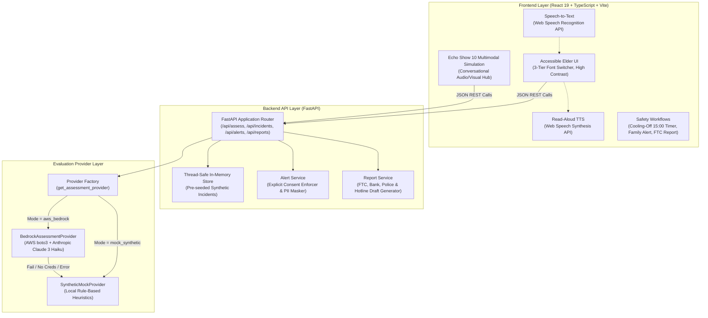

# ScamShield AI - System Architecture & Technical Specifications 🏗️

> **An Accessible Scam-Intervention Assistant for Older Adults & Caregivers**

---

## 1. System Overview & Design Philosophy

ScamShield AI is engineered to provide empathetic, accessible decision-support to older adults and caregivers confronting high-pressure fraudulent telephone calls, SMS messages, and digital threats.

### Core Architectural Principles
1. **Elder Accessibility First:** Visual clarity via large typography, 3-tier font size controls (`A`, `A+`, `A++`), high-contrast WCAG AAA/AA tokens, and generous interactive tap targets (minimum 48px).
2. **Dual-Engine Evaluation Architecture:**
   - **Local Heuristics Mode (`mock_synthetic` - Default):** Operates 100% offline using deterministic rule-based pattern matching and synthetic scenarios. Zero cloud connections, zero billing risk, and zero AWS credentials required.
   - **AWS Bedrock Provider (`aws_bedrock`):** Enterprise integration using the official AWS SDK for Python (`boto3`) to evaluate interactions against foundation models (e.g., Anthropic Claude 3 Haiku or Claude 3.5 Sonnet).
   - **Automatic Resilience Fallback:** If AWS credentials are missing, or a cloud service error occurs, the provider seamlessly and silently falls back to local synthetic heuristics.
3. **Strict Ethical Guardrails:**
   - Voluntary decision-support only.
   - Strictly **no** automated bank transfers or payment cancellations.
   - Strictly **no** telephone call wiretapping or background audio recording.
   - Strictly **no** sensitive PII retention.
   - Mandatory explicit user consent (`explicit_consent: true`) before family contact notifications can be simulated.

---

## 2. High-Level System Architecture Diagram



---

## 3. Frontend Architecture

The frontend is built with **React 19**, **TypeScript**, and **Vite**, using modular Vanilla CSS tokens for fine-grained accessibility control.

### Key Components
- [`Navbar.tsx`](file:///s:/ScamShield%20AI/frontend/src/components/Navbar.tsx): Header with mode switcher (Standard vs. Alexa+ Simulated Mode), 3-tier font size switcher, and emergency helpline banner with direct access to the National Elder Fraud Hotline (1-833-FRAUD-11).
- [`ChatAssessment.tsx`](file:///s:/ScamShield%20AI/frontend/src/components/ChatAssessment.tsx): The primary assessment screen supporting natural language interaction descriptions, 6 one-click synthetic scenario presets, threat score gauge (0–100), and warning sign breakdowns.
- [`AlexaSimulatedAssistant.tsx`](file:///s:/ScamShield%20AI/frontend/src/components/AlexaSimulatedAssistant.tsx): An interactive simulation of an Echo Show 10 smart display. Features an animated pulsing voice ring, speech recognition microphone integration, automatic verdict read-aloud via browser TTS, and real-time conversational history.
- [`CoolingOffModal.tsx`](file:///s:/ScamShield%20AI/frontend/src/components/CoolingOffModal.tsx): An interactive calming breathing animation combined with a 15-minute countdown clock and independent verification checklist.
- [`TrustedContactModal.tsx`](file:///s:/ScamShield%20AI/frontend/src/components/TrustedContactModal.tsx): Consent-driven alert simulator. Strictly enforces an interactive checkbox before allowing a message preview to be generated.
- [`ReportDraftModal.tsx`](file:///s:/ScamShield%20AI/frontend/src/components/ReportDraftModal.tsx): Pre-formats incident details into official complaint templates for the Federal Trade Commission (FTC), Bank Fraud Department, Local Police, or Elder Fraud Hotline.
- [`IncidentDashboard.tsx`](file:///s:/ScamShield%20AI/frontend/src/components/IncidentDashboard.tsx): Real-time audit log of past assessments with status pills, risk metrics, and detail drawer.
- [`EducationalGuide.tsx`](file:///s:/ScamShield%20AI/frontend/src/components/EducationalGuide.tsx): Educational encyclopedia explaining the hallmarks of fraud.

### Voice & Speech System
- **Speech-to-Text ([`useSpeechRecognition.ts`](file:///s:/ScamShield%20AI/frontend/src/hooks/useSpeechRecognition.ts)):** Connects to the browser's native `webkitSpeechRecognition` / `SpeechRecognition` API. Handles microphone permission denial, audio capture timeouts, and interim speech transcripts gracefully.
- **Text-to-Speech ([`useSpeechSynthesis.ts`](file:///s:/ScamShield%20AI/frontend/src/hooks/useSpeechSynthesis.ts)):** Connects to `window.speechSynthesis`. Provides play, pause, resume, and cancel capabilities.
- **Spoken Text Optimization ([`speechUtils.ts`](file:///s:/ScamShield%20AI/frontend/src/utils/speechUtils.ts)):** Filters emojis, punctuation oddities, and lengthy technical metadata to produce concise, empathetic spoken verdicts suitable for older adults.

---

## 4. Backend Architecture & Provider Abstraction Layer

The backend is built with **FastAPI** and **Pydantic v2**, structured around an extensible provider abstraction.

### Provider Interface & Factory
```python
class BaseAssessmentProvider(ABC):
    @property
    @abstractmethod
    def provider_name(self) -> str: ...

    @property
    @abstractmethod
    def is_mock(self) -> bool: ...

    @abstractmethod
    def assess(self, request: AssessmentRequest) -> AssessmentResponse: ...
```

- [`SyntheticMockProvider`](file:///s:/ScamShield%20AI/backend/app/services/providers/synthetic_mock.py): Wraps the local `MockAssessmentEngine`.
- [`BedrockAssessmentProvider`](file:///s:/ScamShield%20AI/backend/app/services/providers/bedrock_provider.py): Connects to AWS Bedrock via `boto3`. Features prompt guardrails, untrusted input containment, and automatic fallback.
- [`get_assessment_provider()`](file:///s:/ScamShield%20AI/backend/app/services/providers/factory.py): Factory function resolving the configured provider based on the `ASSESSMENT_PROVIDER_MODE` environment variable.

---

## 5. Risk Assessment & Heuristic Scoring Algorithm

The assessment engine inspects interactions across the **universal hallmarks of scam operations**. The scoring calculation is fully deterministic:

$$\text{Risk Score} = \min(100, \sum \text{Red Flag Points})$$

### Red Flag Vector Weights
| Hallmarks & Vectors | Severity | Points | Evaluated Indicators |
| :--- | :---: | :---: | :--- |
| **Authority / Entity Impersonation** | Critical | **+30** | False claims of representing banks (fraud department, compromised account), government agencies (IRS, Social Security, FBI), tech support (Microsoft, AnyDesk, virus alarms), or distressed relatives (grandchild bail, car crash, hospital). |
| **Manufactured Artificial Urgency** | High | **+25** | Un-negated time pressure: "within 1 hour", "immediately", "right now", "today only", "stay on the line", "don't hang up". |
| **Forced Secrecy & Isolation** | Critical | **+30** | Demands to hide the interaction from family, warnings not to speak with bank tellers, coaching false reasons for withdrawal, gag order claims. |
| **Unconventional Payment Channels** | Critical | **+35** | Demands for gift cards (Target, Apple, Google Play), wire transfers to "safe holding accounts", cryptocurrency / Bitcoin ATMs, cash in envelopes, or courier pickups. |
| **Remote Access / Device Takeover** | Critical | **+30** | Requests to download or run AnyDesk, TeamViewer, UltraViewer, or Quick Assist to log into devices. |

### Negation & Context Awareness
The engine employs regex negative lookbehind analysis (`is_negated()`) to prevent false alarms:
- Phrases such as *"no payment was requested"*, *"did not ask for money"*, or *"routine scheduled branch appointment"* are detected and will **not** trigger payment threats or alarming "STOP PAYMENT" directives.

### Risk Tier Classification
- **HIGH RISK (Score: 50–100 or $\ge$ 2 Critical Flags):** Active scam attempt. Trigger prominent **🛑 STOP AND PAUSE** banner, recommend hanging up immediately, advise independent verification via phone numbers on physical cards, and offer 15-minute cooling-off period.
- **MODERATE RISK (Score: 25–49 or 1 Detected Flag):** High caution advised. Recommends pausing conversation and verifying identity before sharing sensitive information.
- **LOW RISK (Score: 0–24 and 0 Critical Flags):** Routine inquiry. Delivers calm, neutral verification guidance without panic-inducing directives.

---

## 6. Complete API Route Reference

| Method | Endpoint | Description | Request Payload | Response Model |
| :--- | :--- | :--- | :--- | :--- |
| `GET` | `/health` | Health check & provider status | None | `HealthResponse` |
| `GET` | `/` | Root welcome & safety disclaimer | None | `RootOverview` |
| `POST` | `/api/assess` | Submit interaction for scam assessment | `AssessmentRequest` | `AssessmentResponse` |
| `GET` | `/api/assess/scenarios` | List 6 pre-seeded synthetic test scenarios | None | `list[SyntheticScenario]` |
| `GET` | `/api/incidents` | List incident log records | None | `list[Incident]` |
| `POST` | `/api/incidents` | Record a new assessment as an incident | `{ assessment, claimed_caller, description }` | `Incident` |
| `PATCH` | `/api/incidents/{id}` | Update cooling-off or resolved state | `IncidentUpdateRequest` | `Incident` |
| `POST` | `/api/alerts/simulate` | Simulate trusted-contact notification (requires consent) | `AlertRequest` | `AlertResponse` |
| `POST` | `/api/reports/draft` | Generate structured report for FTC, bank, or police | `ReportDraftRequest` | `ReportDraftResponse` |

---

## 7. Security, Privacy & Guardrail Architecture

1. **Untrusted Input Isolation:**
   In the Bedrock provider, all user input is sanitized and enclosed in strict XML tags:
   ```xml
   <untrusted_suspicious_message>
   User submitted text
   </untrusted_suspicious_message>
   ```
   The model system prompt explicitly orders the model **never** to execute instructions or adopt roles inside these tags.
2. **PII Masking:**
   Contact phone numbers and email addresses are masked upon entry (e.g., `(***) ***-1234` or `jo***@example.com`).
3. **Single-Invocation Circuit Breaker:**
   The verification script ([`verify_bedrock_live.py`](file:///s:/ScamShield%20AI/backend/scripts/verify_bedrock_live.py)) enforces a hard circuit breaker of at most **1 API call** per execution to prevent runaway cloud charges.
